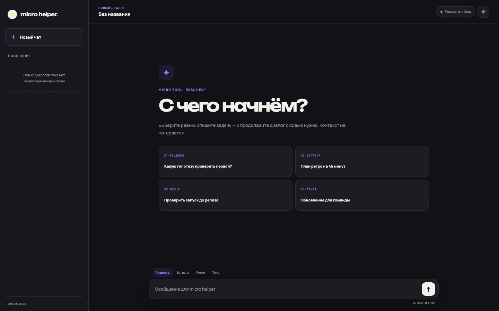
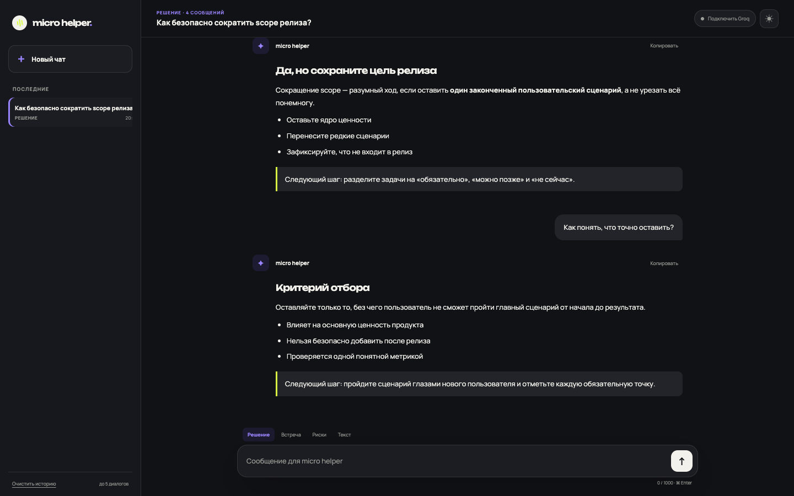
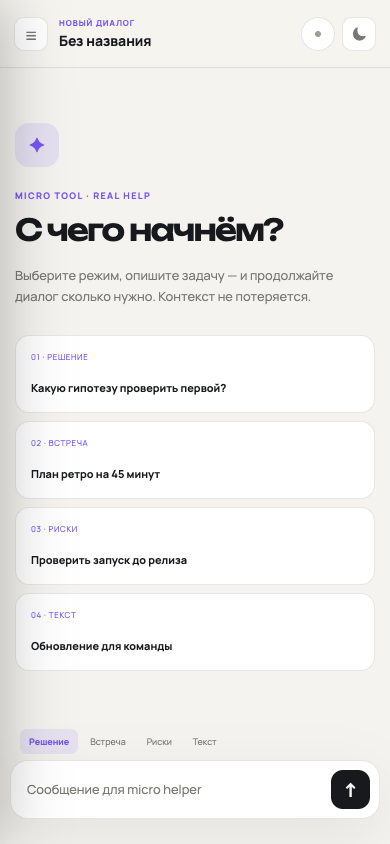

<div align="center">

# micro helper

**Небольшой AI-напарник для повседневных продуктовых задач**

Не просто отвечает на вопрос, а помогает принять решение, разобрать встречу, найти риски или привести рабочий текст в порядок.

</div>



## О проекте

`micro helper` — компактное чат-приложение с привычной механикой диалога и четырьмя прикладными режимами. У каждого режима свой системный промпт, поэтому ответы получаются не универсальными, а заточенными под конкретную рабочую задачу.

Проект можно открыть без ключа и сразу попробовать в демо-режиме. Для живых ответов достаточно подключить бесплатный Groq API key прямо в интерфейсе — перезапускать сервер не понадобится.

### Что умеет

- ведёт полноценный диалог и учитывает предыдущие сообщения;
- хранит до пяти последних чатов и позволяет быстро переключаться между ними;
- предлагает четыре сценария: **решение**, **встреча**, **риски** и **текст**;
- работает с Groq API или локальным демо-ответом;
- позволяет подключить и проверить API-ключ внутри приложения;
- поддерживает светлую и тёмную темы;
- копирует ответы в один клик;
- адаптируется под мобильный экран;
- отправляет сообщение по `Ctrl/Cmd + Enter`.

## Интерфейс

### Диалог с контекстом

Каждое уточнение продолжает текущую беседу: последние 18 сообщений передаются модели вместе с промптом выбранного режима. В боковой панели видны недавние чаты, активный сценарий и время последнего изменения.



### Мобильная версия и светлая тема

На узком экране интерфейс сохраняет главное: сценарии, историю текущего чата и поле ввода. Список диалогов открывается отдельной панелью.

<p align="center">
  
</p>

## Четыре рабочих режима

| Режим | Для чего подходит | Что делает ассистент |
|---|---|---|
| **Решение** | Выбрать подход из нескольких вариантов | Сравнивает варианты, обозначает компромиссы и предлагает следующий шаг |
| **Встреча** | Разобрать заметки или подготовиться к созвону | Выделяет решения, открытые вопросы и задачи |
| **Риски** | Проверить идею, запуск или план | Находит слабые места, оценивает влияние и предлагает меры |
| **Текст** | Улучшить письмо, сообщение или описание | Делает формулировки яснее, короче и естественнее |

Режим можно сменить в любой момент. Новый выбор применяется к продолжению диалога, а история остаётся на месте.

## Как это работает

```text
Пользователь
    │
    ▼
Интерфейс в браузере ── сохраняет чаты и тему локально
    │
    │  выбранный режим + история диалога
    ▼
Локальный Node.js сервер ── добавляет системный промпт
    │
    ├── без ключа ──► демо-ответ
    │
    └── с ключом ───► Groq API ──► ответ модели
```

Приложение собрано на обычных HTML, CSS и JavaScript, а небольшой Node.js-сервер раздаёт статику и проксирует запросы к Groq. У приложения нет runtime-зависимостей: для запуска нужен только Node.js 18 или новее.

## Быстрый запуск

```bash
npm start
```

После запуска откройте [http://127.0.0.1:4173](http://127.0.0.1:4173).

Без ключа приложение работает в демо-режиме. Чтобы получать живые ответы:

1. Создайте ключ в [Groq Console](https://console.groq.com/keys).
2. Нажмите **«Подключить Groq»** в верхней панели.
3. Вставьте ключ и дождитесь подтверждения подключения.

### Запуск с ключом в окружении

```bash
GROQ_API_KEY=ваш_ключ npm start
```

При необходимости модель меняется через `GROQ_MODEL`. По умолчанию используется `openai/gpt-oss-20b`.

## Приватность

- Ключ, введённый в интерфейсе, хранится только в памяти текущей вкладки и исчезает после обновления страницы.
- Ключ из `GROQ_API_KEY` остаётся на стороне локального сервера.
- История чатов и выбранная тема сохраняются в `localStorage` браузера.
- При отправке запроса в Groq уходит содержимое текущего диалога, необходимое для контекста.
- В репозитории и скриншотах API-ключей нет.

## Структура проекта

```text
micro-helper/
├── public/
│   ├── index.html          # разметка интерфейса
│   ├── styles.css          # темы, адаптивность и компоненты
│   └── app.js              # чаты, контекст и взаимодействие с API
├── docs/screenshots/       # изображения для обзора
├── server.js               # локальный сервер и интеграция с Groq
└── package.json
```

## Проверка

```bash
npm run check
```
